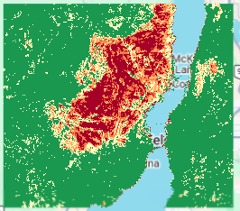

# Burn Severity Mapping with dNBR – McDougall Creek Fire (2023)

A self-learning remote sensing project: mapping the burn severity of the August 2023 McDougall Creek wildfire near West Kelowna, British Columbia, using Landsat 8/9 imagery in Google Earth Engine.

## Method

1. **Data:** Landsat 8 and 9 Collection 2 Level-2 surface reflectance, with clouds and cloud shadows masked using the `QA_PIXEL` band.
2. **Composites:** median composites before the fire (15 Jun – 10 Aug 2023, 13 images) and after it (1 Sep – 31 Oct 2023, 15 images).
3. **NBR (Normalized Burn Ratio):** `(NIR − SWIR2) / (NIR + SWIR2)`. Healthy vegetation scores high and burned ground scores low.
4. **dNBR:** pre-fire NBR minus post-fire NBR. A bigger drop means a more severe burn.
5. **Classification:** standard USGS (Key & Benson) thresholds, with burned area computed per class at 30 m resolution.

## Results

| Class | Severity | dNBR range | Area (ha) |
|---|---|---|---|
| 0 | Unburned | < 0.10 | 34,677 |
| 1 | Low | 0.10 – 0.27 | 5,136 |
| 2 | Moderate-low | 0.27 – 0.44 | 2,664 |
| 3 | Moderate-high | 0.44 – 0.66 | 2,585 |
| 4 | High | > 0.66 | 4,699 |
| | **Total burned (1–4)** | | **15,084** |

The estimated burned area (~15,100 ha) is within about 8% of the official BC Wildfire Service final size of 13,970 ha. Nearly half of the burned area (~7,300 ha) was classed as moderate-high or high severity.

## Limitations

- The "low" class also picks up changes that aren't from this fire, such as drought stress and harvesting, so it overestimates burned area slightly.
- The area of interest is a rectangle, and the northern edge of the scar touches its boundary.
- dNBR measures spectral change, not ground-truthed severity. No field (CBI) data was used.

## How to run

1. Sign up for Google Earth Engine (free for non-commercial use).
2. Open the [Code Editor](https://code.earthengine.google.com), paste `dnbr_mcdougall.js` and click **Run**.
3. Results print in the Console, and the map layers can be toggled in the Layers panel.
